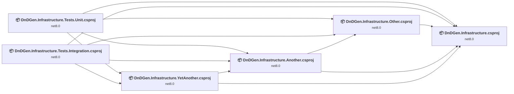
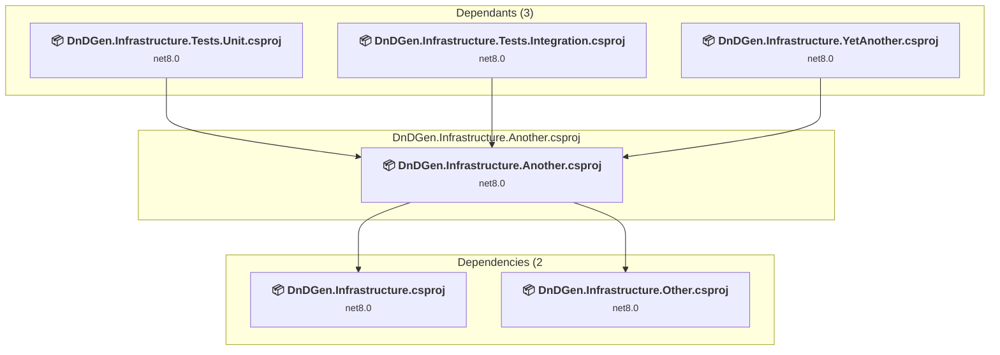
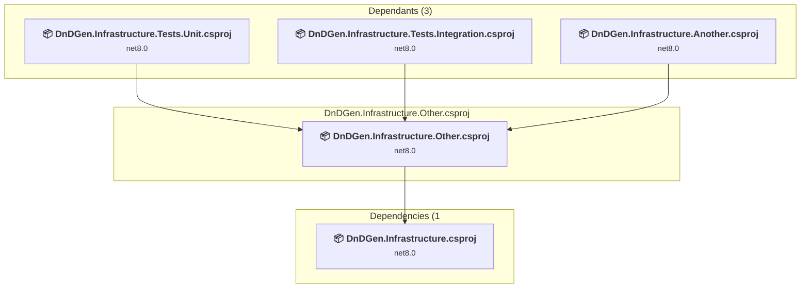
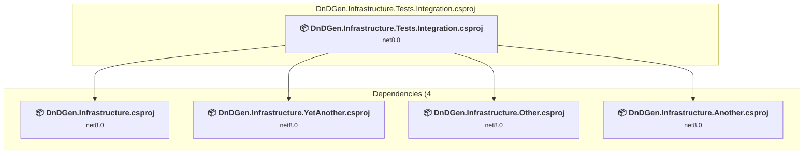
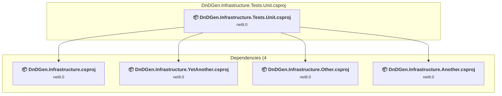
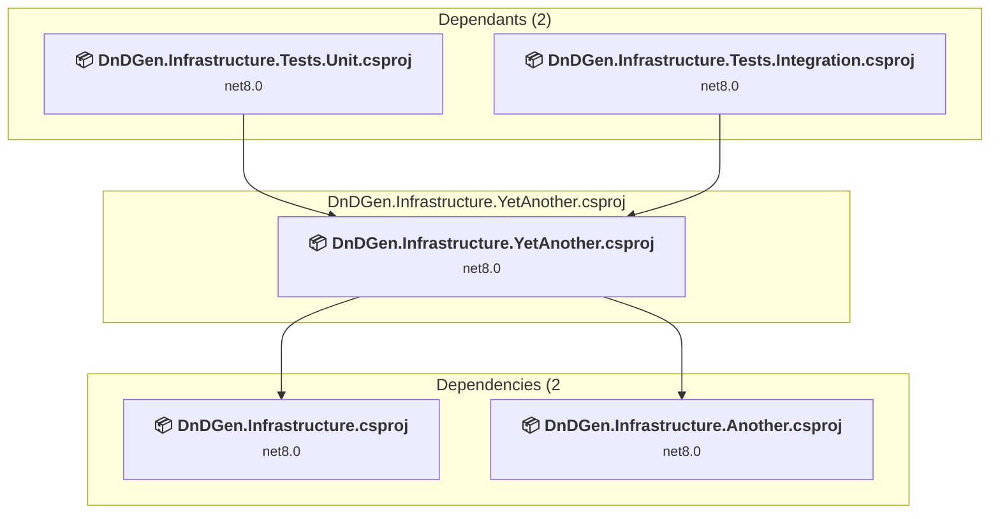
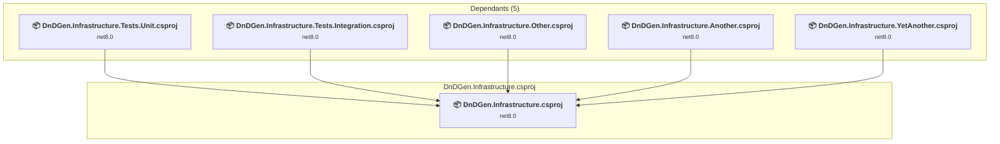

# Projects and dependencies analysis

This document provides a comprehensive overview of the projects and their dependencies in the context of upgrading to .NETCoreApp,Version=v10.0.

## Table of Contents

- [Executive Summary](#executive-Summary)
  - [Highlevel Metrics](#highlevel-metrics)
  - [Projects Compatibility](#projects-compatibility)
  - [Package Compatibility](#package-compatibility)
  - [API Compatibility](#api-compatibility)
  - [Binding Redirect Configuration](#binding-redirect-configuration)
- [Aggregate NuGet packages details](#aggregate-nuget-packages-details)
- [Top API Migration Challenges](#top-api-migration-challenges)
  - [Technologies and Features](#technologies-and-features)
  - [Most Frequent API Issues](#most-frequent-api-issues)
- [Projects Relationship Graph](#projects-relationship-graph)
- [Project Details](#project-details)

  - [DnDGen.Infrastructure.Another\DnDGen.Infrastructure.Another.csproj](#dndgeninfrastructureanotherdndgeninfrastructureanothercsproj)
  - [DnDGen.Infrastructure.Other\DnDGen.Infrastructure.Other.csproj](#dndgeninfrastructureotherdndgeninfrastructureothercsproj)
  - [DnDGen.Infrastructure.Tests.Integration\DnDGen.Infrastructure.Tests.Integration.csproj](#dndgeninfrastructuretestsintegrationdndgeninfrastructuretestsintegrationcsproj)
  - [DnDGen.Infrastructure.Tests.Unit\DnDGen.Infrastructure.Tests.Unit.csproj](#dndgeninfrastructuretestsunitdndgeninfrastructuretestsunitcsproj)
  - [DnDGen.Infrastructure.YetAnother\DnDGen.Infrastructure.YetAnother.csproj](#dndgeninfrastructureyetanotherdndgeninfrastructureyetanothercsproj)
  - [DnDGen.Infrastructure\DnDGen.Infrastructure.csproj](#dndgeninfrastructuredndgeninfrastructurecsproj)

## Executive Summary

### Highlevel Metrics

| Metric | Count | Status |
| :--- | :---: | :--- |
| Total Projects | 6 | All require upgrade |
| Total NuGet Packages | 40 | All compatible |
| Total Code Files | 85 |  |
| Total Code Files with Incidents | 6 |  |
| Total Lines of Code | 6965 |  |
| Total Number of Issues | 6 |  |
| Estimated LOC to modify | 0+ | at least 0.0% of codebase |

### Projects Compatibility

| Project | Target Framework | Difficulty | Package Issues | API Issues | Binding Issues | Est. LOC Impact | Description |
| :--- | :---: | :---: | :---: | :---: | :---: | :---: | :--- |
| [DnDGen.Infrastructure.Another\DnDGen.Infrastructure.Another.csproj](#dndgeninfrastructureanotherdndgeninfrastructureanothercsproj) | net8.0 | 🟢 Low | 0 | 0 | 0 |  | ClassLibrary, Sdk Style = True |
| [DnDGen.Infrastructure.Other\DnDGen.Infrastructure.Other.csproj](#dndgeninfrastructureotherdndgeninfrastructureothercsproj) | net8.0 | 🟢 Low | 0 | 0 | 0 |  | ClassLibrary, Sdk Style = True |
| [DnDGen.Infrastructure.Tests.Integration\DnDGen.Infrastructure.Tests.Integration.csproj](#dndgeninfrastructuretestsintegrationdndgeninfrastructuretestsintegrationcsproj) | net8.0 | 🟢 Low | 0 | 0 | 0 |  | DotNetCoreApp, Sdk Style = True |
| [DnDGen.Infrastructure.Tests.Unit\DnDGen.Infrastructure.Tests.Unit.csproj](#dndgeninfrastructuretestsunitdndgeninfrastructuretestsunitcsproj) | net8.0 | 🟢 Low | 0 | 0 | 0 |  | DotNetCoreApp, Sdk Style = True |
| [DnDGen.Infrastructure.YetAnother\DnDGen.Infrastructure.YetAnother.csproj](#dndgeninfrastructureyetanotherdndgeninfrastructureyetanothercsproj) | net8.0 | 🟢 Low | 0 | 0 | 0 |  | ClassLibrary, Sdk Style = True |
| [DnDGen.Infrastructure\DnDGen.Infrastructure.csproj](#dndgeninfrastructuredndgeninfrastructurecsproj) | net8.0 | 🟢 Low | 0 | 0 | 0 |  | ClassLibrary, Sdk Style = True |

### Package Compatibility

| Status | Count | Percentage |
| :--- | :---: | :---: |
| ✅ Compatible | 40 | 100.0% |
| ⚠️ Incompatible | 0 | 0.0% |
| 🔄 Upgrade Recommended | 0 | 0.0% |
| ***Total NuGet Packages*** | ***40*** | ***100%*** |

### API Compatibility

| Category | Count | Impact |
| :--- | :---: | :--- |
| 🔴 Binary Incompatible | 0 | High - Require code changes |
| 🟡 Source Incompatible | 0 | Medium - Needs re-compilation and potential conflicting API error fixing |
| 🔵 Behavioral change | 0 | Low - Behavioral changes that may require testing at runtime |
| ✅ Compatible | 16406 |  |
| ***Total APIs Analyzed*** | ***16406*** |  |

## Aggregate NuGet packages details

| Package | Current Version | Suggested Version | Projects | Description |
| :--- | :---: | :---: | :--- | :--- |
| Albatross.Dates | 7.5.13 |  | [DnDGen.Infrastructure.Another.csproj](#dndgeninfrastructureanotherdndgeninfrastructureanothercsproj) [DnDGen.Infrastructure.csproj](#dndgeninfrastructuredndgeninfrastructurecsproj) [DnDGen.Infrastructure.Other.csproj](#dndgeninfrastructureotherdndgeninfrastructureothercsproj) [DnDGen.Infrastructure.Tests.Integration.csproj](#dndgeninfrastructuretestsintegrationdndgeninfrastructuretestsintegrationcsproj) [DnDGen.Infrastructure.Tests.Unit.csproj](#dndgeninfrastructuretestsunitdndgeninfrastructuretestsunitcsproj) [DnDGen.Infrastructure.YetAnother.csproj](#dndgeninfrastructureyetanotherdndgeninfrastructureyetanothercsproj) | ✅Compatible |
| Albatross.Expression | 5.0.0 |  | [DnDGen.Infrastructure.Another.csproj](#dndgeninfrastructureanotherdndgeninfrastructureanothercsproj) [DnDGen.Infrastructure.csproj](#dndgeninfrastructuredndgeninfrastructurecsproj) [DnDGen.Infrastructure.Other.csproj](#dndgeninfrastructureotherdndgeninfrastructureothercsproj) [DnDGen.Infrastructure.Tests.Integration.csproj](#dndgeninfrastructuretestsintegrationdndgeninfrastructuretestsintegrationcsproj) [DnDGen.Infrastructure.Tests.Unit.csproj](#dndgeninfrastructuretestsunitdndgeninfrastructuretestsunitcsproj) [DnDGen.Infrastructure.YetAnother.csproj](#dndgeninfrastructureyetanotherdndgeninfrastructureyetanothercsproj) | ✅Compatible |
| Castle.Core | 5.1.1 |  | [DnDGen.Infrastructure.Tests.Unit.csproj](#dndgeninfrastructuretestsunitdndgeninfrastructuretestsunitcsproj) | ✅Compatible |
| DnDGen.RollGen | 16.0.5 |  | [DnDGen.Infrastructure.Another.csproj](#dndgeninfrastructureanotherdndgeninfrastructureanothercsproj) [DnDGen.Infrastructure.csproj](#dndgeninfrastructuredndgeninfrastructurecsproj) [DnDGen.Infrastructure.Other.csproj](#dndgeninfrastructureotherdndgeninfrastructureothercsproj) [DnDGen.Infrastructure.Tests.Integration.csproj](#dndgeninfrastructuretestsintegrationdndgeninfrastructuretestsintegrationcsproj) [DnDGen.Infrastructure.Tests.Unit.csproj](#dndgeninfrastructuretestsunitdndgeninfrastructuretestsunitcsproj) [DnDGen.Infrastructure.YetAnother.csproj](#dndgeninfrastructureyetanotherdndgeninfrastructureyetanothercsproj) | ✅Compatible |
| Humanizer.Core | 2.14.1 |  | [DnDGen.Infrastructure.Another.csproj](#dndgeninfrastructureanotherdndgeninfrastructureanothercsproj) [DnDGen.Infrastructure.csproj](#dndgeninfrastructuredndgeninfrastructurecsproj) [DnDGen.Infrastructure.Other.csproj](#dndgeninfrastructureotherdndgeninfrastructureothercsproj) [DnDGen.Infrastructure.Tests.Integration.csproj](#dndgeninfrastructuretestsintegrationdndgeninfrastructuretestsintegrationcsproj) [DnDGen.Infrastructure.Tests.Unit.csproj](#dndgeninfrastructuretestsunitdndgeninfrastructuretestsunitcsproj) [DnDGen.Infrastructure.YetAnother.csproj](#dndgeninfrastructureyetanotherdndgeninfrastructureyetanothercsproj) | ✅Compatible |
| Json.More.Net | 2.1.1 |  | [DnDGen.Infrastructure.Another.csproj](#dndgeninfrastructureanotherdndgeninfrastructureanothercsproj) [DnDGen.Infrastructure.csproj](#dndgeninfrastructuredndgeninfrastructurecsproj) [DnDGen.Infrastructure.Other.csproj](#dndgeninfrastructureotherdndgeninfrastructureothercsproj) [DnDGen.Infrastructure.Tests.Integration.csproj](#dndgeninfrastructuretestsintegrationdndgeninfrastructuretestsintegrationcsproj) [DnDGen.Infrastructure.Tests.Unit.csproj](#dndgeninfrastructuretestsunitdndgeninfrastructuretestsunitcsproj) [DnDGen.Infrastructure.YetAnother.csproj](#dndgeninfrastructureyetanotherdndgeninfrastructureyetanothercsproj) | ✅Compatible |
| JsonPointer.Net | 5.3.1 |  | [DnDGen.Infrastructure.Another.csproj](#dndgeninfrastructureanotherdndgeninfrastructureanothercsproj) [DnDGen.Infrastructure.csproj](#dndgeninfrastructuredndgeninfrastructurecsproj) [DnDGen.Infrastructure.Other.csproj](#dndgeninfrastructureotherdndgeninfrastructureothercsproj) [DnDGen.Infrastructure.Tests.Integration.csproj](#dndgeninfrastructuretestsintegrationdndgeninfrastructuretestsintegrationcsproj) [DnDGen.Infrastructure.Tests.Unit.csproj](#dndgeninfrastructuretestsunitdndgeninfrastructuretestsunitcsproj) [DnDGen.Infrastructure.YetAnother.csproj](#dndgeninfrastructureyetanotherdndgeninfrastructureyetanothercsproj) | ✅Compatible |
| Microsoft.ApplicationInsights | 2.23.0 |  | [DnDGen.Infrastructure.Tests.Integration.csproj](#dndgeninfrastructuretestsintegrationdndgeninfrastructuretestsintegrationcsproj) [DnDGen.Infrastructure.Tests.Unit.csproj](#dndgeninfrastructuretestsunitdndgeninfrastructuretestsunitcsproj) | ✅Compatible |
| Microsoft.CodeCoverage | 18.3.0 |  | [DnDGen.Infrastructure.Tests.Integration.csproj](#dndgeninfrastructuretestsintegrationdndgeninfrastructuretestsintegrationcsproj) [DnDGen.Infrastructure.Tests.Unit.csproj](#dndgeninfrastructuretestsunitdndgeninfrastructuretestsunitcsproj) | ✅Compatible |
| Microsoft.NET.Test.Sdk | 18.3.0 |  | [DnDGen.Infrastructure.Tests.Integration.csproj](#dndgeninfrastructuretestsintegrationdndgeninfrastructuretestsintegrationcsproj) [DnDGen.Infrastructure.Tests.Unit.csproj](#dndgeninfrastructuretestsunitdndgeninfrastructuretestsunitcsproj) | ✅Compatible |
| Microsoft.NETCore.Platforms | 1.1.0 |  | [DnDGen.Infrastructure.Another.csproj](#dndgeninfrastructureanotherdndgeninfrastructureanothercsproj) [DnDGen.Infrastructure.csproj](#dndgeninfrastructuredndgeninfrastructurecsproj) [DnDGen.Infrastructure.Other.csproj](#dndgeninfrastructureotherdndgeninfrastructureothercsproj) [DnDGen.Infrastructure.Tests.Integration.csproj](#dndgeninfrastructuretestsintegrationdndgeninfrastructuretestsintegrationcsproj) [DnDGen.Infrastructure.Tests.Unit.csproj](#dndgeninfrastructuretestsunitdndgeninfrastructuretestsunitcsproj) [DnDGen.Infrastructure.YetAnother.csproj](#dndgeninfrastructureyetanotherdndgeninfrastructureyetanothercsproj) | ✅Compatible |
| Microsoft.NETCore.Targets | 1.1.0 |  | [DnDGen.Infrastructure.Another.csproj](#dndgeninfrastructureanotherdndgeninfrastructureanothercsproj) [DnDGen.Infrastructure.csproj](#dndgeninfrastructuredndgeninfrastructurecsproj) [DnDGen.Infrastructure.Other.csproj](#dndgeninfrastructureotherdndgeninfrastructureothercsproj) [DnDGen.Infrastructure.Tests.Integration.csproj](#dndgeninfrastructuretestsintegrationdndgeninfrastructuretestsintegrationcsproj) [DnDGen.Infrastructure.Tests.Unit.csproj](#dndgeninfrastructuretestsunitdndgeninfrastructuretestsunitcsproj) [DnDGen.Infrastructure.YetAnother.csproj](#dndgeninfrastructureyetanotherdndgeninfrastructureyetanothercsproj) | ✅Compatible |
| Microsoft.Testing.Extensions.Telemetry | 2.0.2 |  | [DnDGen.Infrastructure.Tests.Integration.csproj](#dndgeninfrastructuretestsintegrationdndgeninfrastructuretestsintegrationcsproj) [DnDGen.Infrastructure.Tests.Unit.csproj](#dndgeninfrastructuretestsunitdndgeninfrastructuretestsunitcsproj) | ✅Compatible |
| Microsoft.Testing.Extensions.TrxReport.Abstractions | 2.0.2 |  | [DnDGen.Infrastructure.Tests.Integration.csproj](#dndgeninfrastructuretestsintegrationdndgeninfrastructuretestsintegrationcsproj) [DnDGen.Infrastructure.Tests.Unit.csproj](#dndgeninfrastructuretestsunitdndgeninfrastructuretestsunitcsproj) | ✅Compatible |
| Microsoft.Testing.Extensions.VSTestBridge | 2.0.2 |  | [DnDGen.Infrastructure.Tests.Integration.csproj](#dndgeninfrastructuretestsintegrationdndgeninfrastructuretestsintegrationcsproj) [DnDGen.Infrastructure.Tests.Unit.csproj](#dndgeninfrastructuretestsunitdndgeninfrastructuretestsunitcsproj) | ✅Compatible |
| Microsoft.Testing.Platform | 2.0.2 |  | [DnDGen.Infrastructure.Tests.Integration.csproj](#dndgeninfrastructuretestsintegrationdndgeninfrastructuretestsintegrationcsproj) [DnDGen.Infrastructure.Tests.Unit.csproj](#dndgeninfrastructuretestsunitdndgeninfrastructuretestsunitcsproj) | ✅Compatible |
| Microsoft.Testing.Platform.MSBuild | 2.0.2 |  | [DnDGen.Infrastructure.Tests.Integration.csproj](#dndgeninfrastructuretestsintegrationdndgeninfrastructuretestsintegrationcsproj) [DnDGen.Infrastructure.Tests.Unit.csproj](#dndgeninfrastructuretestsunitdndgeninfrastructuretestsunitcsproj) | ✅Compatible |
| Microsoft.TestPlatform.AdapterUtilities | 18.0.1 |  | [DnDGen.Infrastructure.Tests.Integration.csproj](#dndgeninfrastructuretestsintegrationdndgeninfrastructuretestsintegrationcsproj) [DnDGen.Infrastructure.Tests.Unit.csproj](#dndgeninfrastructuretestsunitdndgeninfrastructuretestsunitcsproj) | ✅Compatible |
| Microsoft.TestPlatform.ObjectModel | 18.3.0 |  | [DnDGen.Infrastructure.Tests.Integration.csproj](#dndgeninfrastructuretestsintegrationdndgeninfrastructuretestsintegrationcsproj) [DnDGen.Infrastructure.Tests.Unit.csproj](#dndgeninfrastructuretestsunitdndgeninfrastructuretestsunitcsproj) | ✅Compatible |
| Microsoft.TestPlatform.TestHost | 18.3.0 |  | [DnDGen.Infrastructure.Tests.Integration.csproj](#dndgeninfrastructuretestsintegrationdndgeninfrastructuretestsintegrationcsproj) [DnDGen.Infrastructure.Tests.Unit.csproj](#dndgeninfrastructuretestsunitdndgeninfrastructuretestsunitcsproj) | ✅Compatible |
| Moq | 4.20.72 |  | [DnDGen.Infrastructure.Tests.Unit.csproj](#dndgeninfrastructuretestsunitdndgeninfrastructuretestsunitcsproj) | ✅Compatible |
| Newtonsoft.Json | 13.0.3 |  | [DnDGen.Infrastructure.Tests.Integration.csproj](#dndgeninfrastructuretestsintegrationdndgeninfrastructuretestsintegrationcsproj) [DnDGen.Infrastructure.Tests.Unit.csproj](#dndgeninfrastructuretestsunitdndgeninfrastructuretestsunitcsproj) | ✅Compatible |
| Ninject | 3.3.6 |  | [DnDGen.Infrastructure.Another.csproj](#dndgeninfrastructureanotherdndgeninfrastructureanothercsproj) [DnDGen.Infrastructure.csproj](#dndgeninfrastructuredndgeninfrastructurecsproj) [DnDGen.Infrastructure.Other.csproj](#dndgeninfrastructureotherdndgeninfrastructureothercsproj) [DnDGen.Infrastructure.Tests.Integration.csproj](#dndgeninfrastructuretestsintegrationdndgeninfrastructuretestsintegrationcsproj) [DnDGen.Infrastructure.Tests.Unit.csproj](#dndgeninfrastructuretestsunitdndgeninfrastructuretestsunitcsproj) [DnDGen.Infrastructure.YetAnother.csproj](#dndgeninfrastructureyetanotherdndgeninfrastructureyetanothercsproj) | ✅Compatible |
| NUnit | 4.5.0 |  | [DnDGen.Infrastructure.Tests.Integration.csproj](#dndgeninfrastructuretestsintegrationdndgeninfrastructuretestsintegrationcsproj) [DnDGen.Infrastructure.Tests.Unit.csproj](#dndgeninfrastructuretestsunitdndgeninfrastructuretestsunitcsproj) | ✅Compatible |
| NUnit3TestAdapter | 6.1.0 |  | [DnDGen.Infrastructure.Tests.Integration.csproj](#dndgeninfrastructuretestsintegrationdndgeninfrastructuretestsintegrationcsproj) [DnDGen.Infrastructure.Tests.Unit.csproj](#dndgeninfrastructuretestsunitdndgeninfrastructuretestsunitcsproj) | ✅Compatible |
| System.Collections.Immutable | 8.0.0 |  | [DnDGen.Infrastructure.Tests.Integration.csproj](#dndgeninfrastructuretestsintegrationdndgeninfrastructuretestsintegrationcsproj) [DnDGen.Infrastructure.Tests.Unit.csproj](#dndgeninfrastructuretestsunitdndgeninfrastructuretestsunitcsproj) | ✅Compatible |
| System.Diagnostics.DiagnosticSource | 5.0.0 |  | [DnDGen.Infrastructure.Tests.Integration.csproj](#dndgeninfrastructuretestsintegrationdndgeninfrastructuretestsintegrationcsproj) [DnDGen.Infrastructure.Tests.Unit.csproj](#dndgeninfrastructuretestsunitdndgeninfrastructuretestsunitcsproj) | ✅Compatible |
| System.Diagnostics.EventLog | 6.0.0 |  | [DnDGen.Infrastructure.Tests.Unit.csproj](#dndgeninfrastructuretestsunitdndgeninfrastructuretestsunitcsproj) | ✅Compatible |
| System.IO | 4.3.0 |  | [DnDGen.Infrastructure.Another.csproj](#dndgeninfrastructureanotherdndgeninfrastructureanothercsproj) [DnDGen.Infrastructure.csproj](#dndgeninfrastructuredndgeninfrastructurecsproj) [DnDGen.Infrastructure.Other.csproj](#dndgeninfrastructureotherdndgeninfrastructureothercsproj) [DnDGen.Infrastructure.Tests.Integration.csproj](#dndgeninfrastructuretestsintegrationdndgeninfrastructuretestsintegrationcsproj) [DnDGen.Infrastructure.Tests.Unit.csproj](#dndgeninfrastructuretestsunitdndgeninfrastructuretestsunitcsproj) [DnDGen.Infrastructure.YetAnother.csproj](#dndgeninfrastructureyetanotherdndgeninfrastructureyetanothercsproj) | ✅Compatible |
| System.IO.Pipelines | 9.0.10 |  | [DnDGen.Infrastructure.Another.csproj](#dndgeninfrastructureanotherdndgeninfrastructureanothercsproj) [DnDGen.Infrastructure.csproj](#dndgeninfrastructuredndgeninfrastructurecsproj) [DnDGen.Infrastructure.Other.csproj](#dndgeninfrastructureotherdndgeninfrastructureothercsproj) [DnDGen.Infrastructure.Tests.Integration.csproj](#dndgeninfrastructuretestsintegrationdndgeninfrastructuretestsintegrationcsproj) [DnDGen.Infrastructure.Tests.Unit.csproj](#dndgeninfrastructuretestsunitdndgeninfrastructuretestsunitcsproj) [DnDGen.Infrastructure.YetAnother.csproj](#dndgeninfrastructureyetanotherdndgeninfrastructureyetanothercsproj) | ✅Compatible |
| System.Reflection | 4.3.0 |  | [DnDGen.Infrastructure.Another.csproj](#dndgeninfrastructureanotherdndgeninfrastructureanothercsproj) [DnDGen.Infrastructure.csproj](#dndgeninfrastructuredndgeninfrastructurecsproj) [DnDGen.Infrastructure.Other.csproj](#dndgeninfrastructureotherdndgeninfrastructureothercsproj) [DnDGen.Infrastructure.Tests.Integration.csproj](#dndgeninfrastructuretestsintegrationdndgeninfrastructuretestsintegrationcsproj) [DnDGen.Infrastructure.Tests.Unit.csproj](#dndgeninfrastructuretestsunitdndgeninfrastructuretestsunitcsproj) [DnDGen.Infrastructure.YetAnother.csproj](#dndgeninfrastructureyetanotherdndgeninfrastructureyetanothercsproj) | ✅Compatible |
| System.Reflection.Emit.ILGeneration | 4.3.0 |  | [DnDGen.Infrastructure.Another.csproj](#dndgeninfrastructureanotherdndgeninfrastructureanothercsproj) [DnDGen.Infrastructure.csproj](#dndgeninfrastructuredndgeninfrastructurecsproj) [DnDGen.Infrastructure.Other.csproj](#dndgeninfrastructureotherdndgeninfrastructureothercsproj) [DnDGen.Infrastructure.Tests.Integration.csproj](#dndgeninfrastructuretestsintegrationdndgeninfrastructuretestsintegrationcsproj) [DnDGen.Infrastructure.Tests.Unit.csproj](#dndgeninfrastructuretestsunitdndgeninfrastructuretestsunitcsproj) [DnDGen.Infrastructure.YetAnother.csproj](#dndgeninfrastructureyetanotherdndgeninfrastructureyetanothercsproj) | ✅Compatible |
| System.Reflection.Emit.Lightweight | 4.3.0 |  | [DnDGen.Infrastructure.Another.csproj](#dndgeninfrastructureanotherdndgeninfrastructureanothercsproj) [DnDGen.Infrastructure.csproj](#dndgeninfrastructuredndgeninfrastructurecsproj) [DnDGen.Infrastructure.Other.csproj](#dndgeninfrastructureotherdndgeninfrastructureothercsproj) [DnDGen.Infrastructure.Tests.Integration.csproj](#dndgeninfrastructuretestsintegrationdndgeninfrastructuretestsintegrationcsproj) [DnDGen.Infrastructure.Tests.Unit.csproj](#dndgeninfrastructuretestsunitdndgeninfrastructuretestsunitcsproj) [DnDGen.Infrastructure.YetAnother.csproj](#dndgeninfrastructureyetanotherdndgeninfrastructureyetanothercsproj) | ✅Compatible |
| System.Reflection.Metadata | 8.0.0 |  | [DnDGen.Infrastructure.Tests.Integration.csproj](#dndgeninfrastructuretestsintegrationdndgeninfrastructuretestsintegrationcsproj) [DnDGen.Infrastructure.Tests.Unit.csproj](#dndgeninfrastructuretestsunitdndgeninfrastructuretestsunitcsproj) | ✅Compatible |
| System.Reflection.Primitives | 4.3.0 |  | [DnDGen.Infrastructure.Another.csproj](#dndgeninfrastructureanotherdndgeninfrastructureanothercsproj) [DnDGen.Infrastructure.csproj](#dndgeninfrastructuredndgeninfrastructurecsproj) [DnDGen.Infrastructure.Other.csproj](#dndgeninfrastructureotherdndgeninfrastructureothercsproj) [DnDGen.Infrastructure.Tests.Integration.csproj](#dndgeninfrastructuretestsintegrationdndgeninfrastructuretestsintegrationcsproj) [DnDGen.Infrastructure.Tests.Unit.csproj](#dndgeninfrastructuretestsunitdndgeninfrastructuretestsunitcsproj) [DnDGen.Infrastructure.YetAnother.csproj](#dndgeninfrastructureyetanotherdndgeninfrastructureyetanothercsproj) | ✅Compatible |
| System.Runtime | 4.3.0 |  | [DnDGen.Infrastructure.Another.csproj](#dndgeninfrastructureanotherdndgeninfrastructureanothercsproj) [DnDGen.Infrastructure.csproj](#dndgeninfrastructuredndgeninfrastructurecsproj) [DnDGen.Infrastructure.Other.csproj](#dndgeninfrastructureotherdndgeninfrastructureothercsproj) [DnDGen.Infrastructure.Tests.Integration.csproj](#dndgeninfrastructuretestsintegrationdndgeninfrastructuretestsintegrationcsproj) [DnDGen.Infrastructure.Tests.Unit.csproj](#dndgeninfrastructuretestsunitdndgeninfrastructuretestsunitcsproj) [DnDGen.Infrastructure.YetAnother.csproj](#dndgeninfrastructureyetanotherdndgeninfrastructureyetanothercsproj) | ✅Compatible |
| System.Text.Encoding | 4.3.0 |  | [DnDGen.Infrastructure.Another.csproj](#dndgeninfrastructureanotherdndgeninfrastructureanothercsproj) [DnDGen.Infrastructure.csproj](#dndgeninfrastructuredndgeninfrastructurecsproj) [DnDGen.Infrastructure.Other.csproj](#dndgeninfrastructureotherdndgeninfrastructureothercsproj) [DnDGen.Infrastructure.Tests.Integration.csproj](#dndgeninfrastructuretestsintegrationdndgeninfrastructuretestsintegrationcsproj) [DnDGen.Infrastructure.Tests.Unit.csproj](#dndgeninfrastructuretestsunitdndgeninfrastructuretestsunitcsproj) [DnDGen.Infrastructure.YetAnother.csproj](#dndgeninfrastructureyetanotherdndgeninfrastructureyetanothercsproj) | ✅Compatible |
| System.Text.Encodings.Web | 9.0.10 |  | [DnDGen.Infrastructure.Another.csproj](#dndgeninfrastructureanotherdndgeninfrastructureanothercsproj) [DnDGen.Infrastructure.csproj](#dndgeninfrastructuredndgeninfrastructurecsproj) [DnDGen.Infrastructure.Other.csproj](#dndgeninfrastructureotherdndgeninfrastructureothercsproj) [DnDGen.Infrastructure.Tests.Integration.csproj](#dndgeninfrastructuretestsintegrationdndgeninfrastructuretestsintegrationcsproj) [DnDGen.Infrastructure.Tests.Unit.csproj](#dndgeninfrastructuretestsunitdndgeninfrastructuretestsunitcsproj) [DnDGen.Infrastructure.YetAnother.csproj](#dndgeninfrastructureyetanotherdndgeninfrastructureyetanothercsproj) | ✅Compatible |
| System.Text.Json | 9.0.10 |  | [DnDGen.Infrastructure.Another.csproj](#dndgeninfrastructureanotherdndgeninfrastructureanothercsproj) [DnDGen.Infrastructure.csproj](#dndgeninfrastructuredndgeninfrastructurecsproj) [DnDGen.Infrastructure.Other.csproj](#dndgeninfrastructureotherdndgeninfrastructureothercsproj) [DnDGen.Infrastructure.Tests.Integration.csproj](#dndgeninfrastructuretestsintegrationdndgeninfrastructuretestsintegrationcsproj) [DnDGen.Infrastructure.Tests.Unit.csproj](#dndgeninfrastructuretestsunitdndgeninfrastructuretestsunitcsproj) [DnDGen.Infrastructure.YetAnother.csproj](#dndgeninfrastructureyetanotherdndgeninfrastructureyetanothercsproj) | ✅Compatible |
| System.Threading.Tasks | 4.3.0 |  | [DnDGen.Infrastructure.Another.csproj](#dndgeninfrastructureanotherdndgeninfrastructureanothercsproj) [DnDGen.Infrastructure.csproj](#dndgeninfrastructuredndgeninfrastructurecsproj) [DnDGen.Infrastructure.Other.csproj](#dndgeninfrastructureotherdndgeninfrastructureothercsproj) [DnDGen.Infrastructure.Tests.Integration.csproj](#dndgeninfrastructuretestsintegrationdndgeninfrastructuretestsintegrationcsproj) [DnDGen.Infrastructure.Tests.Unit.csproj](#dndgeninfrastructuretestsunitdndgeninfrastructuretestsunitcsproj) [DnDGen.Infrastructure.YetAnother.csproj](#dndgeninfrastructureyetanotherdndgeninfrastructureyetanothercsproj) | ✅Compatible |

## Top API Migration Challenges

### Technologies and Features

| Technology | Issues | Percentage | Migration Path |
| :--- | :---: | :---: | :--- |

### Most Frequent API Issues

| API | Count | Percentage | Category |
| :--- | :---: | :---: | :--- |

## Projects Relationship Graph

Legend:
📦 SDK-style project
⚙️ Classic project

## Project Details

### DnDGen.Infrastructure.Another\DnDGen.Infrastructure.Another.csproj

#### Project Info

- **Current Target Framework:** net8.0
- **Proposed Target Framework:** net10.0
- **SDK-style**: True
- **Project Kind:** ClassLibrary
- **Dependencies**: 2
- **Dependants**: 3
- **Number of Files**: 5
- **Number of Files with Incidents**: 1
- **Lines of Code**: 56
- **Estimated LOC to modify**: 0+ (at least 0.0% of the project)

#### Dependency Graph

Legend:
📦 SDK-style project
⚙️ Classic project

### API Compatibility

| Category | Count | Impact |
| :--- | :---: | :--- |
| 🔴 Binary Incompatible | 0 | High - Require code changes |
| 🟡 Source Incompatible | 0 | Medium - Needs re-compilation and potential conflicting API error fixing |
| 🔵 Behavioral change | 0 | Low - Behavioral changes that may require testing at runtime |
| ✅ Compatible | 34 |  |
| ***Total APIs Analyzed*** | ***34*** |  |

### DnDGen.Infrastructure.Other\DnDGen.Infrastructure.Other.csproj

#### Project Info

- **Current Target Framework:** net8.0
- **Proposed Target Framework:** net10.0
- **SDK-style**: True
- **Project Kind:** ClassLibrary
- **Dependencies**: 1
- **Dependants**: 3
- **Number of Files**: 8
- **Number of Files with Incidents**: 1
- **Lines of Code**: 53
- **Estimated LOC to modify**: 0+ (at least 0.0% of the project)

#### Dependency Graph

Legend:
📦 SDK-style project
⚙️ Classic project

### API Compatibility

| Category | Count | Impact |
| :--- | :---: | :--- |
| 🔴 Binary Incompatible | 0 | High - Require code changes |
| 🟡 Source Incompatible | 0 | Medium - Needs re-compilation and potential conflicting API error fixing |
| 🔵 Behavioral change | 0 | Low - Behavioral changes that may require testing at runtime |
| ✅ Compatible | 33 |  |
| ***Total APIs Analyzed*** | ***33*** |  |

### DnDGen.Infrastructure.Tests.Integration\DnDGen.Infrastructure.Tests.Integration.csproj

#### Project Info

- **Current Target Framework:** net8.0
- **Proposed Target Framework:** net10.0
- **SDK-style**: True
- **Project Kind:** DotNetCoreApp
- **Dependencies**: 4
- **Dependants**: 0
- **Number of Files**: 37
- **Number of Files with Incidents**: 1
- **Lines of Code**: 1929
- **Estimated LOC to modify**: 0+ (at least 0.0% of the project)

#### Dependency Graph

Legend:
📦 SDK-style project
⚙️ Classic project

### API Compatibility

| Category | Count | Impact |
| :--- | :---: | :--- |
| 🔴 Binary Incompatible | 0 | High - Require code changes |
| 🟡 Source Incompatible | 0 | Medium - Needs re-compilation and potential conflicting API error fixing |
| 🔵 Behavioral change | 0 | Low - Behavioral changes that may require testing at runtime |
| ✅ Compatible | 5953 |  |
| ***Total APIs Analyzed*** | ***5953*** |  |

### DnDGen.Infrastructure.Tests.Unit\DnDGen.Infrastructure.Tests.Unit.csproj

#### Project Info

- **Current Target Framework:** net8.0
- **Proposed Target Framework:** net10.0
- **SDK-style**: True
- **Project Kind:** DotNetCoreApp
- **Dependencies**: 4
- **Dependants**: 0
- **Number of Files**: 25
- **Number of Files with Incidents**: 1
- **Lines of Code**: 3824
- **Estimated LOC to modify**: 0+ (at least 0.0% of the project)

#### Dependency Graph

Legend:
📦 SDK-style project
⚙️ Classic project

### API Compatibility

| Category | Count | Impact |
| :--- | :---: | :--- |
| 🔴 Binary Incompatible | 0 | High - Require code changes |
| 🟡 Source Incompatible | 0 | Medium - Needs re-compilation and potential conflicting API error fixing |
| 🔵 Behavioral change | 0 | Low - Behavioral changes that may require testing at runtime |
| ✅ Compatible | 9227 |  |
| ***Total APIs Analyzed*** | ***9227*** |  |

### DnDGen.Infrastructure.YetAnother\DnDGen.Infrastructure.YetAnother.csproj

#### Project Info

- **Current Target Framework:** net8.0
- **Proposed Target Framework:** net10.0
- **SDK-style**: True
- **Project Kind:** ClassLibrary
- **Dependencies**: 2
- **Dependants**: 2
- **Number of Files**: 5
- **Number of Files with Incidents**: 1
- **Lines of Code**: 54
- **Estimated LOC to modify**: 0+ (at least 0.0% of the project)

#### Dependency Graph

Legend:
📦 SDK-style project
⚙️ Classic project

### API Compatibility

| Category | Count | Impact |
| :--- | :---: | :--- |
| 🔴 Binary Incompatible | 0 | High - Require code changes |
| 🟡 Source Incompatible | 0 | Medium - Needs re-compilation and potential conflicting API error fixing |
| 🔵 Behavioral change | 0 | Low - Behavioral changes that may require testing at runtime |
| ✅ Compatible | 34 |  |
| ***Total APIs Analyzed*** | ***34*** |  |

### DnDGen.Infrastructure\DnDGen.Infrastructure.csproj

#### Project Info

- **Current Target Framework:** net8.0
- **Proposed Target Framework:** net10.0
- **SDK-style**: True
- **Project Kind:** ClassLibrary
- **Dependencies**: 0
- **Dependants**: 5
- **Number of Files**: 35
- **Number of Files with Incidents**: 1
- **Lines of Code**: 1049
- **Estimated LOC to modify**: 0+ (at least 0.0% of the project)

#### Dependency Graph

Legend:
📦 SDK-style project
⚙️ Classic project

### API Compatibility

| Category | Count | Impact |
| :--- | :---: | :--- |
| 🔴 Binary Incompatible | 0 | High - Require code changes |
| 🟡 Source Incompatible | 0 | Medium - Needs re-compilation and potential conflicting API error fixing |
| 🔵 Behavioral change | 0 | Low - Behavioral changes that may require testing at runtime |
| ✅ Compatible | 1125 |  |
| ***Total APIs Analyzed*** | ***1125*** |  |

